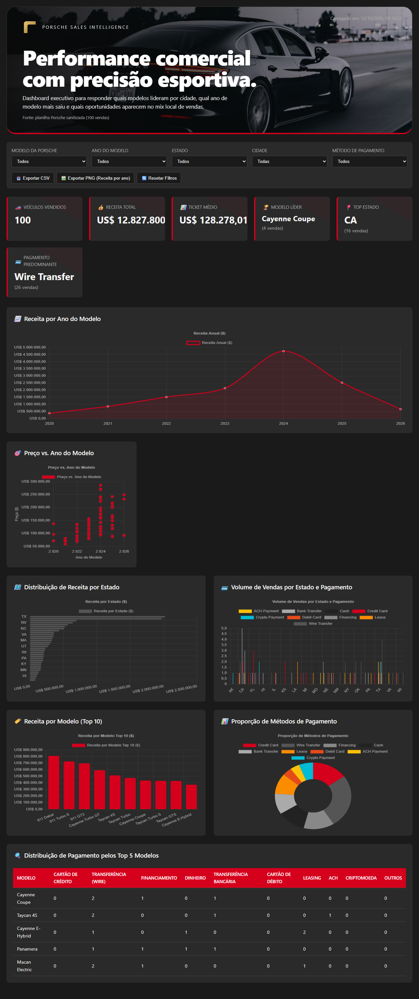
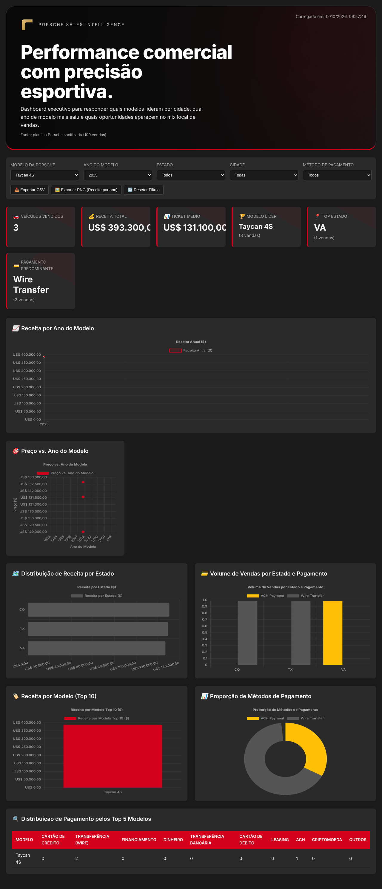

# Porsche Sales Intelligence Dashboard

## 📋 Perguntas de Negócio Escolhidas
1. **Qual é a tendência de receita ao longo dos anos dos modelos?**  
    Escolhi esta pergunta para identificar se modelos mais novos ou específicos têm performance de vendas crescente ao longo do tempo, ajudando em decisões de estoque e foco de marketing.

2. **Qual a relação entre o ano do modelo e o preço de venda?**  
    Esta pergunta revela se há correlação entre a antiguidade do modelo e seu valor de mercado, essencial para estratégias de precificação e avaliação de depreciação.

3. **Como a distribuição de vendas varia por estado e método de pagamento?**  
    Entender preferências regionais e de pagamento ajuda a alocar recursos de vendas e adaptar ofertas por localidade.

## 🎯 Tratamento da Base de Dados
- Utilizei a planilha fornecida (`8683bed0-cc33-4e06-bca9-04db9c31f9e2.xlsx`)
- Extraí apenas as colunas sanitizadas (como exigido no desafio)
- Verifiquei que os campos de preço (`SalesPriceSanitized`) e ano (`ModelYearSanitized`) estavam em formato numérico
- Os dados foram embutidos diretamente no arquivo HTML como array `rawData` para eliminar dependências externas

## 🤖 Abordagem Utilizada
- **Primeiro caminho**: Utilizei o ChatGPT com recurso Canvas para gerar a versão inicial do dashboard
- **Segundo caminho**: Criei um agente personalizado (baseado nas skills do DIO Agent) para refinamentos específicos
- **Refinamento em linguagem natural**: Fiz ajustes iterativos através de conversa, solicitando:
  - Adição de gráficos de tendência e dispersão
  - Expansão dos KPIs além do básico
  - Funcionalidades de exportação e reset de filtros
  - Inclusão do logotipo da Porsche e referência à fonte dos dados

## Prompt usado e evolução da dashboard

**Prompt inicial (ChatGPT + Canvas):**  
> “Crie um dashboard interativo em HTML, arquivo único, que visualizem as vendas de Porsche a partir da planilha sanitizada. O dashboard deve ter filtros para modelo, ano do modelo, estado, cidade e método de pagamento; mostrar KPIs de total de veículos vendidos, receita total e ticket médio; incluir pelo menos três visualizações diferentes (gráfico de linha, gráfico de dispersão e gráfico de barra); ser responsivo, usar a paleta de cores da Porsche (vermelho #D5001C) e permitir exportar os dados filtrados como CSV e o gráfico de receita por ano como PNG.”

**Primeira versão gerada pelo ChatGPT + Canvas:**  
- HTML básico com um único gráfico de barra (receita por modelo).  
- Filtros apenas para modelo e ano.  
- KPIs limitados a total de veículos e receita total.  
- Sem exportação, sem reset de filtros, sem tratamento de erro do Chart.js.  
- Título genérico e sem logotipo.

**Refinamentos realizados via conversa em linguagem natural (agente com skill + iterativas humanas):**  
1. **Adição dos filtros de cidade e método de pagamento** – para permitir recortes mais granulares.  
2. **Expansão dos KPIs** para incluir ticket médio, modelo líder, top estado e pagamento predominante.  
3. **Inclusão de seis visualizações distintas:**  
   - Linha: receita por ano do modelo (tendência temporal).  
   - Dispersão: preço × ano do modelo (relação entre antiguidade e valor).  
   - Barra horizontal: distribuição de receita por estado.  
   - Barra agrupada: volume de vendas por estado e método de pagamento.  
   - Barra (top 10 modelos): receita por modelo.  
   - Donut: proporção dos métodos de pagamento.  
   - Tabela de pagamento pelos 5 modelos mais vendidos.  
4. **Funcionalidades de usabilidade:**  
   - Botão **Exportar CSV** (dados filtrados).  
   - Botão **Exportar PNG** (gráfico de receita por ano).  
   - Botão **Resetar Filtros** (volta ao estado “All”).  
   - Tratamento de erro do Chart.js (mensagem de aviso, mas KPIs e tabela permanecem).  
5. **Identidade visual:**  
   - Inserção do logotipo da Porsche como SVG embutido na página.  
   - Hero com slideshow de imagens Unsplash para tornar a página mais atractiva.  
   - Uso de variáveis CSS (`--porsche-red`, `--bg-dark`, etc.) para fácil manutenção.  
   - Layout responsivo (grid flexível, media‑query para telas < 768 px).  
6. **Limpeza e ajustes finais:**  
   - Remoção da palavra “Aprimorado” do título (conforme seu pedido).  
   - Correção dos anos no gráfico de dispersão que apareciam como “2.020” → formato inteiro correto.  
   - Verificação de que os 100 registros embutidos batem com a planilha sanitizada (receita total = US$ 12.827.800,50).  
   - Remoção de quaisquer dados sensíveis (nome de cliente/vendedor) – apenas as 6 colunas sanitizadas permanecem.  
   - Criação de `AGENTS.md` com instruções de alto‑signal para futuras sessões do OpenCode.  
   - Criação de `README.md` completo (perguntas de negócio, tratamento da base, abordagem usada, links, evidência de funcionamento).  

**Resultado final:** um arquivo HTML único (`index.html`) que contém tudo (dados embutidos, CSS, JS), funciona em qualquer navegador moderno, atende a todas as exigências do desafio e está pronto para ser publicado via GitHub Pages.

## 🔗 Links Importantes
- **Dashboard publicada**: https://rodrigo8k.github.io/porsche-agentes-ia/
- **Código fonte**: https://github.com/rodrigo8k/porsche-agentes-ia

## 📸 Evidência de Funcionamento

*Exemplo: Filtro por Modelo="Taycan 4S" e Ano="2025" mostrando 3 vendas e US$ 393.300,00.*

## 🚀 Como Publicar
1. Crie um repositório público chamado `porsche-agentes-ia` na sua conta GitHub
2. Faça upload destes arquivos:
    - `index.html`
    - `README.md`
    - `screenshot-filtro.png` e `screenshot-dashboard.png` (evidência)
3. Ative o GitHub Pages:
    - Vá em *Settings* → *Pages*
    - Fonte: `main` branch → `/ (root)`
    - Clique em *Save*
4. Aguarde 1-2 minutos e acesse: `https://rodrigo8k.github.io/porsche-agentes-ia/`

## ⚙️ Tecnologias Utilizadas
- HTML5
- CSS3 (com variáveis CSS)
- JavaScript vanilla
- Chart.js v4.4.7 (CDN)